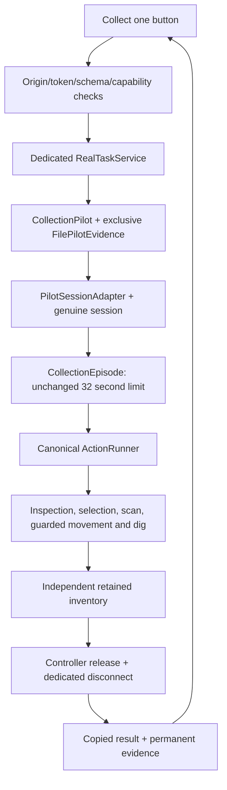

# Dashboard real-game integration

Dashboard-02 implements an **internal, disabled real-session bridge**, not an operational real-game connection. Normal launch paths remain simulation-only. `scripts/pilot-once.mjs` retains its literal false gate; no environment or CLI bypass exists.

## Implemented boundary

`TaskService` provides copied `snapshot`, allowlisted `start`, matching-task `cancel`, `settled`, mode-dependent `reset`, and idempotent `close`. Status includes mode/capabilities/session identity/controller state/readiness/inventory/active task/bounded history. HTTP accepts exact high-level schemas, never constructors, callbacks, attempt paths or session handles. `Simulation` retains all Dashboard-01 operations.

`RealTaskService(handle, attemptId, evidenceRoot)` consumes a dedicated genuine `startSession` handle through `readSessionBinding`'s private registry. Copied/forged associations refuse. A genuine handle can be assigned only once per process. Attempt identity/root are trusted composition inputs; the optional evidence store is an internal fault-injection seam, never HTTP input.

The service constructs one existing `PilotSessionAdapter`, not another ActionRunner. Construct it after spawn and **before own-player metadata delivery**; missing air remains unknown. Do not install a second pilot adapter on that Bot: compatibility ownership rejects duplicate installation. No synthetic stationary receipt is created.

`observeSessionActions` provides bounded read-only telemetry from the genuine session's canonical runner. Only action start/result labels cross this boundary, not Bot objects, raw packets, secrets or execution methods. Each internal listener receives its own record; exceptions cannot affect execution. At most eight observers are allowed; completion clears them and the service unsubscribes. Actual actions are shown while running; selection/navigation/inventory detail appears only when genuine episode evidence is available.

## Admission and lifecycle

- Only `collect_one` is supported. HTTP and service reject other tasks. HTTP checks `canReset`; real `reset()` always throws and never alters a world.
- Submission consumes the service synchronously. Duplicate/different IDs, concurrent tabs and a second service instance cannot cause another episode. Even preflight refusal closes this dedicated session and leaves the service consumed.
- The pilot atomically creates a permanent attempt directory before execution. Partial claim/write failure or an existing marker fails closed. Another process/service with that identity cannot overwrite/retry it. Never delete a marker to retry.
- Survival, original Bot/entity/dimension, health, physics, fresh stationarity, own air, visible support and idle controller remain required. Scanning/body actions retain independent guards and unchanged deadlines.
- Cancellation acknowledges a request, then waits for the owned episode and bounded session shutdown. Dashboard close uses the same path. Refresh/tab closure/polling neither cancels nor replays work; tasks remain bounded without a browser.
- Verified collection requires independent retention, intact session at release, controller release, actual session end and written evidence. Uncertainty never becomes verified. Real history holds one task/100 events; no outcome permits another task/reset.
- `processShutdown: not_observed` remains honest: session closeout cannot prove later process exit. Parent/operator observation is separate.

The existing synchronous evidence writer retains its 32KiB cap, fsync and atomic rename. Ordinary filesystem exceptions fail closed. Hung filesystems/OS, forced kills, power loss or event-loop failure cannot produce confirmed cleanup. Preserve partial markers and investigate; recovery never automatically retries. The launcher cannot prove game-server effects after a network partition.

## Security

Explicit `127.0.0.1` binding, exact Host/Origin/Fetch Metadata checks, random 256-bit CSRF token, JSON mutations, 1KiB bodies, exact keys, high-level allowlist, bounded headers/connections/timeouts and static asset maps remain. Requests cannot select paths, modes, servers, commands, coordinates, raw actions, claimed success or credentials. No public listener/CORS/console endpoint exists. Browser button disabling is presentation only; backend admission enforces authority. This local-user application cannot defend against malicious software running as the same OS user.

## Offline evidence

`test/dashboard-real.test.ts` supplies a controlled fake factory to genuine `startSession`. HTTP races two submissions. The canonical pilot performs inspection, private target selection, guarded scans/movement, digging/simulated server confirmation, actual fake inventory increase, independent retention, release and disconnect. No predetermined successful body response is injected. Final disk evidence and service status agree.

Negative cases cover missing/forged/wrong-Bot association, stale session/physics, changed entity/dimension, mode/health/air/physics, busy controller, duplicate service/task, permanent replay, unsupported second episode, cancellation before start/during movement/at retention, disconnect during digging/before retention, failed dig, absent pickup, contradictory retention, late callbacks, failed evidence/cleanup and shutdown timeout. Server close aborts active work. Snapshots cannot mutate authority. HTTP polling/refresh does not replay; completion needs no persistent browser connection. Existing API/UI/reconnect/concurrency/simulation-reset tests remain.

Run Windows checks separately because they rebuild the checkout: `node --test test/dashboard/launcher-check.mjs`. These execute the actual cmd file from the spaced OneDrive path, preflight/smoke, double launch, unrelated port conflict, Q/EOF shutdown, missing dependencies and invalid live arguments. No browser opens.

## Later activation — new authorization required

1. Authorize **one** disposable Minecraft 26.1/Java 25 Survival session/attempt. Identify an approved loopback server/port, unprivileged bot identity and safe visible supported dirt/grass target. World/server setup is separate. Preserve original DEMO-02 attempts.
2. Implement/review a dedicated operator connection launcher in a new milestone. Keep this simulation launcher unchanged. Use `startSession` with its existing connection lease, capture the genuine handle, construct exactly one `RealTaskService` at spawn before metadata, and bind `startDashboard({service})` to loopback. Do not also call `runPilotSession`: it automatically submits its own pilot rather than waiting for a dashboard click.
3. Reuse bounded connect/readiness/abort handling from the pilot launcher. Add a bounded operator-ready waiting period, close on expiry/disconnect, propagate interruption to `service.close`, and close the dedicated session on startup failure. Attempt ID/evidence root stay fixed and server-owned. No reset, retry or environment bypass.
4. Review a dedicated literal source gate as part of that authorized change. Keep `pilot-once` false unless its separate CLI path is explicitly authorized. Changing that gate alone does not activate the dashboard. No runnable real-dashboard command exists in Dashboard-02.
5. Repeat offline startup/readiness/cancellation/crash-evidence checks for that composition and publish the reviewed activation commit. Operator launches once, opens the site, confirms actual readiness and clicks **Collect one** once. No Codex command is needed per task. The session then disconnects; another attempt needs new authorization.
6. Review target, movement/scans, before/after/retained inventory, release, actual end, permanent closeout and separately observed process exit. Missing evidence means uncertain/refused, not success. Preserve markers after failure.
7. Restore the activation gate to false and record the real technical result. OBS/spectator recording is separate visual acceptance.

Still unverified: real Minecraft protocol/readiness/physics/cancellation/disconnect, browser rendering/accessibility/File Explorer workflow, and any separately requested recording. Offline success does not establish these results.
